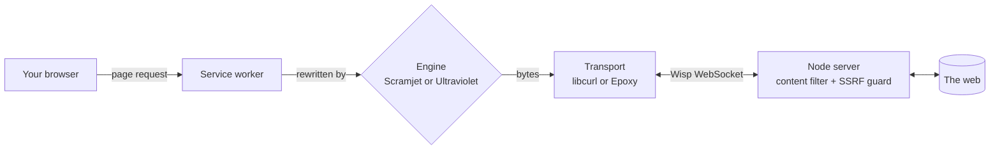

<div align="center">


# SuperNova OS

### A web proxy that looks and feels like Windows 10.

Two switchable proxy engines, a Chrome-style browser with tabs, one-click games, tab cloaking
and a real content filter, all served from a single Node.js app.

<br>

[](LICENSE)
[](https://nodejs.org)
[](docs/PROXY.md)
[](https://dsc.gg/supernovaproxy)

[**Quick start**](#-quick-start) ·
[**Features**](#-features) ·
[**Using it**](#-using-it) ·
[**Configuration**](#-configuration) ·
[**Deploying**](#-deploying) ·
[**Docs**](#-documentation)

<br>


</div>

<br>

## ✨ Features

<table>
<tr>
<td width="50%" valign="top">

### 🚀 Two engines, one switch
[Scramjet](https://github.com/MercuryWorkshop/scramjet) (newest, best compatibility) and
[Ultraviolet](https://github.com/titaniumnetwork-dev/Ultraviolet) (light and well tested).
Swap them live in Settings or from the address bar. No restart.

### 🔌 Two transports
**libcurl** (default) or **Epoxy**, carried over one
[Wisp](https://github.com/MercuryWorkshop/wisp-protocol) WebSocket. Point it at your own Wisp server if you like.

### 🌐 SuperNova Browser
Chrome-style tabs you can drag, pin, duplicate and reopen. **Fullscreen per tab**, zoom, a bookmarks bar,
address suggestions, real URLs in the address bar and an animated new-tab page.

</td>
<td width="50%" valign="top">

### 🎮 Games on the desktop
Thirteen popular browser games, one double-click away, all running through the proxy:
Bloxd.io, Slither.io, Diep.io, Krunker, Paper.io 2, Skribbl.io, Zombs.io, 2048, Survev.io,
Minecraft, Cookie Clicker, Smash Karts and MooMoo.io.

### 🕶️ Cloaking
13 tab disguises, an `about:blank` / `blob:` launcher, a panic key that works inside windows
and proxied pages, and an optional leave-page prompt.

### 🛡️ A real content filter
Enforced on the **server**, so it covers every connection, not only the search box.

</td>
</tr>
</table>

Also included:

- **Windows 10-style Settings**, pinned to the taskbar: a Home page of tiles, *Find a setting* search, Windows toggles and the Fluent *Reveal* highlight.
- **21 wallpapers**, including space (Hubble and Webb images, Saturn, nebulae) and gaming (synthwave, neon grid, pixel invaders, digital rain). Choose *Show more* in Settings > Appearance to see them all.
- **Smart search** with Brave, DuckDuckGo, Google, Bing, Startpage, Ecosia or your own URL, plus optional safe search.
- **Draggable, resizable windows**, a launcher, a terminal and a file explorer.
- **Safe defaults**: the proxy refuses connections to the server's own network (no SSRF), a password is one environment variable away, and no credentials live in the repository.

<br>

<div align="center">

&nbsp;

</div>

<br>

## ⚡ Quick start

```sh
git clone https://github.com/SuperNova-Network/SuperNova-OS.git
cd SuperNova-OS
npm install
npm start
```

Open <http://localhost:3000>. You need **Node.js 20 or newer**.

| Command | What it does |
| --- | --- |
| `npm start` | Run the server |
| `npm run dev` | Run it and restart on file changes |
| `npm test` | Run the test suite |

<br>

## 🧭 Using it

| To... | Do this |
| --- | --- |
| Browse the web | Open **SuperNova** on the desktop, or switch the taskbar search to **Web** and type an address or a search |
| Play a game | Double-click its icon on the desktop |
| Switch engine | Settings > **Proxy** > Engine, or the engine badge in the Browser's address bar |
| Change the connection | Settings > **Proxy** > Connection (libcurl / Epoxy), or set a custom Wisp server |
| Check that it works | Settings > Proxy > Troubleshooting > **Run test** |
| Disguise the tab | Settings > **Cloaking** > Tab disguise |
| Hide instantly | Settings > Cloaking > **Panic key** (for example `Ctrl+Alt+P`) |
| Open in `about:blank` | Settings > Cloaking > **Open in about:blank** |
| Change wallpaper or colours | Settings > **Appearance**, or right-click the desktop |

<details>
<summary><b>Browser keyboard shortcuts</b></summary>

<br>

| Keys | Action |
| --- | --- |
| `Alt+T` / `Alt+W` | New tab / close tab |
| `Alt+Shift+T` | Reopen the last closed tab |
| `Alt+L` | Focus the address bar |
| `Alt+D` | Bookmark the page |
| `Alt+←` / `Alt+→` | Back / forward |
| `F5` | Reload |
| `F11` | Fullscreen this tab |
| `Alt+1` ... `Alt+9` | Jump to a tab |
| `Ctrl+Tab` | Next tab |
| `Alt++` / `Alt+-` / `Alt+0` | Zoom in / out / reset |

</details>

<br>

## 🏗️ How it works



One service worker serves both engines. The Node server only relays bytes over the Wisp WebSocket,
refuses blocked and private addresses, and serves the desktop. The details, including every workaround
and why it exists, are in [docs/ARCHITECTURE.md](docs/ARCHITECTURE.md).

<br>

## ⚙️ Configuration

Everything is optional. Copy `.env.example` to `.env`, or set these in your host's dashboard.

| Variable | Default | Purpose |
| --- | --- | --- |
| `PORT` | `3000` | Port to listen on |
| `AUTH_PASS` | *(empty)* | Set to require a login (HTTP Basic). Empty keeps the site public |
| `AUTH_USER` | `admin` | Username when `AUTH_PASS` is set |
| `CONTENT_FILTER` | `1` | `0` turns the content filter off |
| `BLOCKED_HOSTS` | *(empty)* | Extra domains to block, comma separated |
| `WISP_URL` | *(empty)* | Use an external Wisp server (`wss://...`) instead of this one |
| `OPEN_BROWSER` | *(empty)* | `1` opens your browser on start (local development) |

The full reference is in [docs/CONFIGURATION.md](docs/CONFIGURATION.md).

<br>

## ☁️ Deploying

The proxy runs over a WebSocket, so it needs a host that keeps connections open: Fly.io, Render, Railway,
Heroku, any VPS or any container platform. A `Dockerfile`, `fly.toml` and `render.yaml` are included.

> [!WARNING]
> **Vercel and Netlify functions cannot hold WebSockets open.** Use one of the hosts above, or a static
> host plus an external Wisp server (`WISP_URL`).

> [!IMPORTANT]
> **Running a public instance?** Read [SECURITY.md](SECURITY.md) first. A proxy lets people browse
> *from your server's IP address*.

See [docs/DEPLOYMENT.md](docs/DEPLOYMENT.md) for step-by-step guides.

<br>

## 📚 Documentation

| | |
| --- | --- |
| 🏛️ [Architecture](docs/ARCHITECTURE.md) | How a page load travels through the system |
| 🔀 [Proxy engines and transports](docs/PROXY.md) | Choosing and switching them, search and safe search |
| 🕶️ [Cloaking](docs/CLOAKING.md) | Tab disguise, panic key, `about:blank`, and their limits |
| ⚙️ [Configuration](docs/CONFIGURATION.md) | Environment variables, the content filter, authentication |
| ☁️ [Deployment](docs/DEPLOYMENT.md) | Docker, Fly.io, Render, a VPS with HTTPS |
| 🧑‍💻 [Development](docs/DEVELOPMENT.md) | Project layout, tests, adding an app to the desktop |
| 🩺 [Troubleshooting](docs/TROUBLESHOOTING.md) | When a page will not load |
| 📝 [Changelog](CHANGELOG.md) | What changed from the original project |
| 🔒 [Security](SECURITY.md) | Reporting issues and hardening a public instance |

<br>

## 🤝 Contributing

Bug reports, ideas and pull requests are welcome. Start with [docs/DEVELOPMENT.md](docs/DEVELOPMENT.md),
and come chat on Discord: **[dsc.gg/supernovaproxy](https://dsc.gg/supernovaproxy)**.

<br>

## 📄 License and credits

SuperNova OS is free software under the **GNU Affero General Public License v3.0** ([LICENSE](LICENSE)).
If you run a modified version for others over a network, you must offer them its source code. Settings >
System > About links to this repository for that reason.

Built on [Ultraviolet](https://github.com/titaniumnetwork-dev/Ultraviolet),
[Scramjet](https://github.com/MercuryWorkshop/scramjet),
[bare-mux](https://github.com/MercuryWorkshop/bare-mux),
[libcurl.js](https://github.com/ading2210/libcurl.js),
[epoxy-tls](https://github.com/MercuryWorkshop/epoxy-tls) and
[wisp-js](https://github.com/MercuryWorkshop/wisp-js). The desktop shell is derived from PeOS by
[PicturElements](https://github.com/PicturElements).

Space wallpapers are public-domain images from NASA, ESA and the Hubble and Webb telescopes (via
Wikimedia Commons), except the Andromeda Galaxy photograph by Adam Evans, used under
[CC BY 2.0](https://creativecommons.org/licenses/by/2.0/). The gaming wallpapers were generated for this project.

<div align="center">
<br>
<sub>Made for people who like their proxy to look like a desktop.</sub>
</div>
