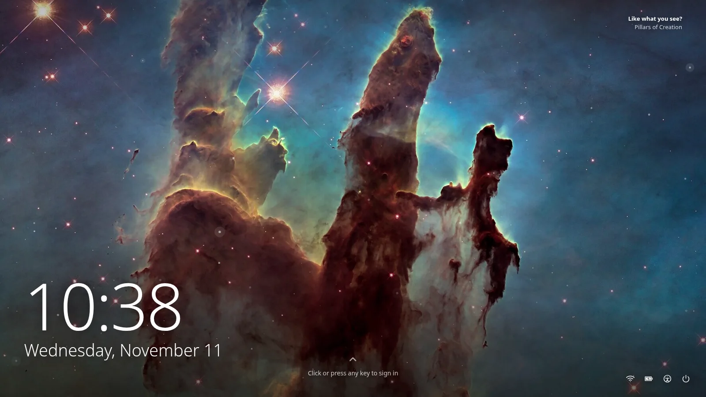
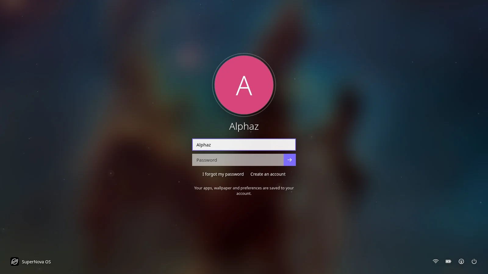
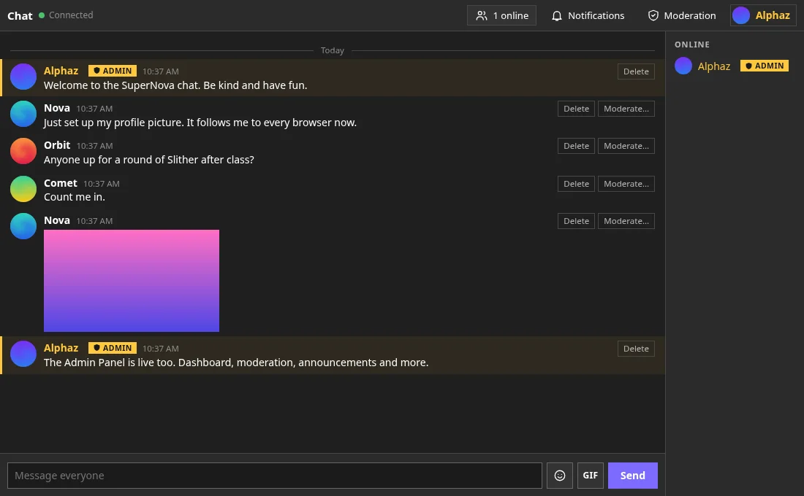
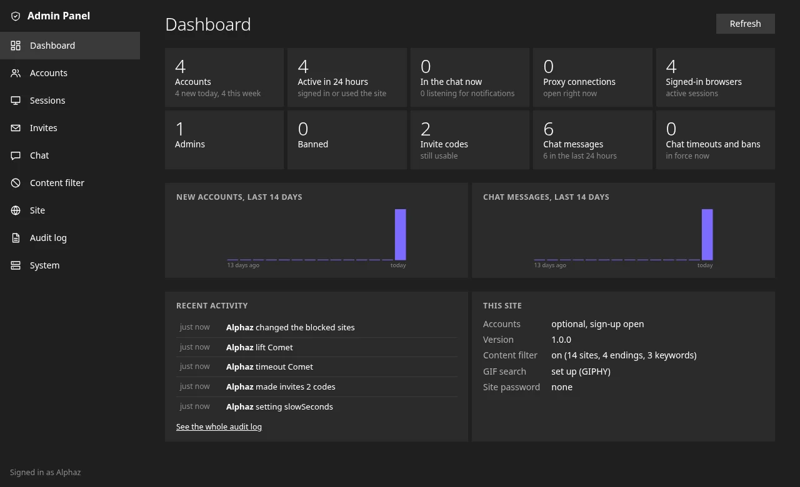
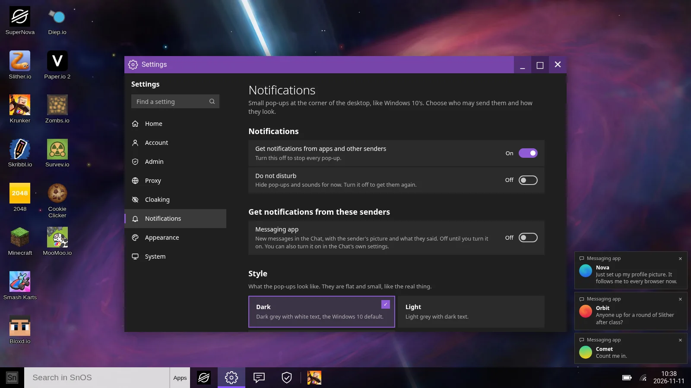
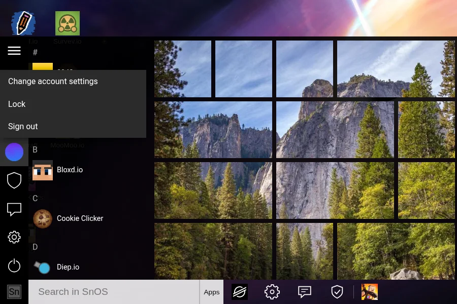
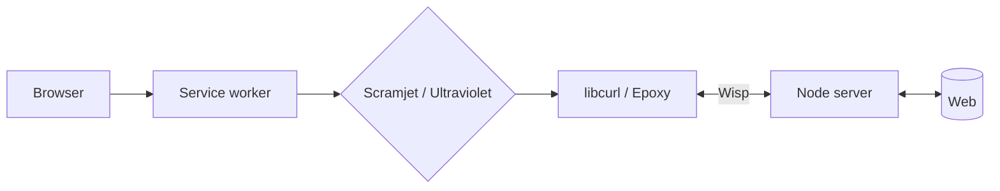

<div align="center">
  
  <h1>SuperNova OS</h1>
  <p>A web proxy with a Windows 10 style desktop.</p>

  <a href="LICENSE"></a>
  <a href="https://nodejs.org"></a>
  <a href="https://dsc.gg/supernovaproxy"></a>
</div>

<br>


SuperNova OS is a web proxy that runs inside a Windows 10 style desktop. It has a tabbed browser, games on the desktop, tab cloaking and a server side content filter. On top of that it has accounts, a live chat, desktop notifications and a full Admin Panel, all from one Node.js app.

## Features

### Browsing

- Two proxy engines, [Scramjet](https://github.com/MercuryWorkshop/scramjet) and [Ultraviolet](https://github.com/titaniumnetwork-dev/Ultraviolet). Switch between them in Settings or from the address bar, no restart needed.
- Two transports, libcurl (default) and Epoxy, both over one [Wisp](https://github.com/MercuryWorkshop/wisp-protocol) WebSocket. You can point it at your own Wisp server.
- Chrome style browser with draggable tabs, pinning, duplicate and reopen, fullscreen per tab, zoom, a bookmarks bar, address suggestions, real URLs in the address bar and an animated new tab page.
- Search with Brave, DuckDuckGo, Google, Bing, Startpage, Ecosia or a custom URL, with optional safe search.
- 13 games on the desktop that run through the proxy: Bloxd.io, Slither.io, Diep.io, Krunker, Paper.io 2, Skribbl.io, Zombs.io, 2048, Survev.io, Minecraft, Cookie Clicker, Smash Karts and MooMoo.io. You can also add your own apps to the desktop.

### The desktop

- A Windows 10 style desktop with draggable and resizable windows, a launcher, a terminal and a file explorer.
- A taskbar that starts with SuperNova, Settings, Chat and (for admins) the Admin Panel, a thin divider, then the apps you pin. Right click any of them to pin or unpin, and the choice follows your account.
- A start menu with your profile at the top. Click it for a Windows 10 style menu with Change account settings, Lock and Sign out.
- A Windows 10 lock screen for signing in: a different wallpaper each visit, a big clock, a frosted sign-in screen and a Welcome screen with Windows' spinning dots. It has Sleep, Restart and Reduce motion controls, and it runs at 60 fps.
- A Settings app in the Windows 10 style, with a tile home page, setting search, toggles and the Fluent Reveal hover effect.
- Notifications: small Windows 10 style pop-ups that stack and fade, with a Settings page for theme, size, corner, sound, how long they stay and Do not disturb.
- 21 wallpapers (space and gaming). Click "Show more" in Settings > Appearance to see all of them.

### Accounts and community

- Accounts (optional or required) that carry your apps, wallpaper, bookmarks, pinned apps and preferences to any browser. There is no email: a recovery code shown once at sign-up resets a forgotten password.
- Invite codes, so you decide who can join, and profile pictures that follow you everywhere.
- A live chat room for everyone signed in, with emoji, GIFs (upload one, or search GIPHY when the server has a key), who is online, spam filters, slow mode and automatic timeouts. Admins get a gold name and an ADMIN badge.
- Optional chat notifications that show the sender's picture and message, off until you turn them on.
- Back up and restore your settings as a file.

### For admins

- An Admin Panel in the same style as Settings, with a dashboard, an account manager (search, sort, bulk actions, per account sessions, chat history, set a password, ban, delete), sessions, invite codes, chat moderation, a content filter you can edit live, announcements, maintenance mode, an audit log, server health and a database backup.
- Chat moderation from the Chat window: delete messages, time out or ban people, lock or clear the chat, and tune the blocked words, links and slow mode.
- The first admin is created from a setup link the server prints on its first start.

### Privacy and safety

- Tab cloaking with 13 disguises, an about:blank / blob: launcher, a panic key that works inside windows and proxied pages, and an optional leave page prompt.
- A content filter that runs on the server, so it covers every connection and not just the search box.
- Blocks connections to the server's own network (SSRF protection), an optional site password through one env variable, and no credentials in the repo.

## Screenshots

<p>
  
  
</p>

<p>
  
  
</p>

<p>
  
  
</p>

<p>
  
  
</p>

## Getting started

You need Node.js 20 or newer, or 22.13 or newer for accounts and the admin panel (they use its built-in SQLite).

```sh
git clone https://github.com/SuperNova-Network/SuperNova-OS.git
cd SuperNova-OS
npm install
npm start
```

Then open http://localhost:3000.

To manage the site, use the setup link the server prints on its first start (open it, enter the code, choose a username and password). It creates the first admin, who gets the Admin Panel and Settings > Admin. Accounts, the chat and the Admin Panel keep their data in one SQLite file under `DATA_DIR`.

Other scripts:

- `npm run dev` restarts the server when files change
- `npm test` runs the tests

## Usage

- Browse: open SuperNova on the desktop, or switch the taskbar search to Web and type a URL or search.
- Games: double click the icon on the desktop.
- Your own apps: right click the desktop > Add an app…, or open the browser menu > Add to desktop. Right click an app you added to rename or remove it.
- Pin and unpin: right click a taskbar icon. SuperNova, Settings, Chat and the Admin Panel stay grouped first, left of the divider.
- Switch engine: Settings > Proxy > Engine, or click the engine badge in the browser's address bar.
- Change transport: Settings > Proxy > Connection. You can also set a custom Wisp server there.
- Test the connection: Settings > Proxy > Troubleshooting > Run test.
- Cloaking: Settings > Cloaking for the tab disguise, panic key (e.g. `Ctrl+Alt+P`) and open in about:blank.
- Wallpaper and colors: Settings > Appearance, or right click the desktop.
- Accounts (when the site has them on): Settings > Account to create one or sign in, and to set your profile picture. When the site requires accounts you sign in on the lock screen instead. Click your profile in the start menu to sign out or lock.
- Chat (needs accounts): the Chat icon on the taskbar opens a live room for everyone signed in, with emoji and GIFs. Admins have a tag beside their name, which admins can restyle in the Chat's moderation panel.
- App Store (needs accounts): the bag icon on the taskbar, after Chat. Browse apps other people published, add one to your desktop with Get, publish your own from Your apps, and report apps that are broken or not appropriate. Depending on the admin's setting, a new app waits for an admin's approval or goes live at once.
- Friends (needs accounts): Search for Friends in the start menu. Once its window is open, right click its taskbar icon and choose Pin to keep it there. Add people by username, accept or decline requests, block anyone, and see which friends are online. You can show as online, away or invisible.
- Site health: the speedometer in the taskbar shows whether the site and the proxy really work, and the small graph beside it shows how fast data is moving through the proxy. Click either for the details, or to run the full proxy test.
- Notifications: Settings > Notifications. You can restyle them, silence them, or turn on Do not disturb. Chat notifications are off until you turn them on, in Settings or in the Chat's own settings.
- Admin Panel (admins): the Admin icon on the taskbar, or Admin in the start menu, or search for "admin". It covers accounts, sessions, invites, chat moderation, App Store approvals and reports, the content filter, announcements, maintenance mode, the audit log, and server tools such as a database backup.
- Back up or move your setup: Settings > System > Backup exports your apps, bookmarks and preferences to a file and imports it again, on any SuperNova site.

<details>
<summary>Browser shortcuts</summary>

| Keys | Action |
| --- | --- |
| `Alt+T` / `Alt+W` | New tab / close tab |
| `Alt+Shift+T` | Reopen last closed tab |
| `Alt+L` | Focus address bar |
| `Alt+D` | Bookmark page |
| `Alt+Left` / `Alt+Right` | Back / forward |
| `F5` | Reload |
| `F11` | Fullscreen tab |
| `Alt+1` to `Alt+9` | Jump to tab |
| `Ctrl+Tab` | Next tab |
| `Alt++` / `Alt+-` / `Alt+0` | Zoom in / out / reset |

</details>

## How it works

Page requests go through a service worker, which rewrites them using whichever engine you picked. The transport (libcurl or Epoxy) sends that traffic over a Wisp WebSocket to the Node server. The server checks it against the content filter and SSRF guard, then relays it. It doesn't rewrite anything itself, it just passes bytes along and serves the desktop.



More detail, including the workarounds and why they're there, is in [docs/ARCHITECTURE.md](docs/ARCHITECTURE.md).

## Configuration

Everything is optional. Copy `.env.example` to `.env` or set these on your host.

| Variable | Default | Description |
| --- | --- | --- |
| `PORT` | `3000` | Port to listen on |
| `AUTH_PASS` | empty | Set this to require a login (HTTP Basic). Leave empty for a public site |
| `AUTH_USER` | `admin` | Username when `AUTH_PASS` is set |
| `CONTENT_FILTER` | `1` | Set to `0` to turn the filter off |
| `BLOCKED_HOSTS` | empty | Extra domains to block, comma separated |
| `WISP_URL` | empty | Use an external Wisp server (`wss://...`) |
| `OPEN_BROWSER` | empty | Set to `1` to open your browser on start |
| `DATA_DIR` | `data` | Where accounts, the chat and the admin panel's choices are stored. Put it on a persistent disk |
| `ACCOUNTS` / `ACCOUNTS_SIGNUP` / `ADMINS` | empty | Optional overrides for what Settings > Admin manages. Leave them unset to choose in the panel |
| `GIPHY_API_KEY` | empty | Turns on GIF search in the chat. Without it people can still upload GIFs |
| `TRUST_PROXY` | empty | Set to `1` behind a hosting platform's proxy (Fly.io, Render, nginx) |

Full reference: [docs/CONFIGURATION.md](docs/CONFIGURATION.md)

## Deploying

The proxy runs over WebSockets, so you need a host that keeps connections open: Fly.io, Render, Railway, Heroku, a VPS or any container platform. A `Dockerfile`, `fly.toml` and `render.yaml` are included.

**Vercel and Netlify won't work** since their functions can't hold WebSockets open. If you want to use one of them, host the static files there and set `WISP_URL` to an external Wisp server.

If you're running a public instance, read [SECURITY.md](SECURITY.md) first. Anyone using it is browsing from your server's IP.

Step by step guides are in [docs/DEPLOYMENT.md](docs/DEPLOYMENT.md).

## Docs

- [Architecture](docs/ARCHITECTURE.md)
- [Proxy engines and transports](docs/PROXY.md)
- [Cloaking](docs/CLOAKING.md)
- [Configuration](docs/CONFIGURATION.md)
- [Deployment](docs/DEPLOYMENT.md)
- [Development](docs/DEVELOPMENT.md)
- [Troubleshooting](docs/TROUBLESHOOTING.md)
- [Changelog](CHANGELOG.md)
- [Security](SECURITY.md)

## Contributing

Issues and PRs are welcome. Check [docs/DEVELOPMENT.md](docs/DEVELOPMENT.md) before you start. You can also find us on [Discord](https://dsc.gg/supernovaproxy).

## License

AGPL-3.0, see [LICENSE](LICENSE). If you host a modified version for other people you have to make the source available to them, which is why Settings > System > About links back to this repo.

## Credits

Built on [Ultraviolet](https://github.com/titaniumnetwork-dev/Ultraviolet), [Scramjet](https://github.com/MercuryWorkshop/scramjet), [bare-mux](https://github.com/MercuryWorkshop/bare-mux), [libcurl.js](https://github.com/ading2210/libcurl.js), [epoxy-tls](https://github.com/MercuryWorkshop/epoxy-tls) and [wisp-js](https://github.com/MercuryWorkshop/wisp-js). The desktop is based on PeOS by [PicturElements](https://github.com/PicturElements).

Space wallpapers are public domain images from NASA, ESA, Hubble and Webb (via Wikimedia Commons), except the Andromeda Galaxy photo by Adam Evans, used under [CC BY 2.0](https://creativecommons.org/licenses/by/2.0/). The gaming wallpapers were generated for this project.
